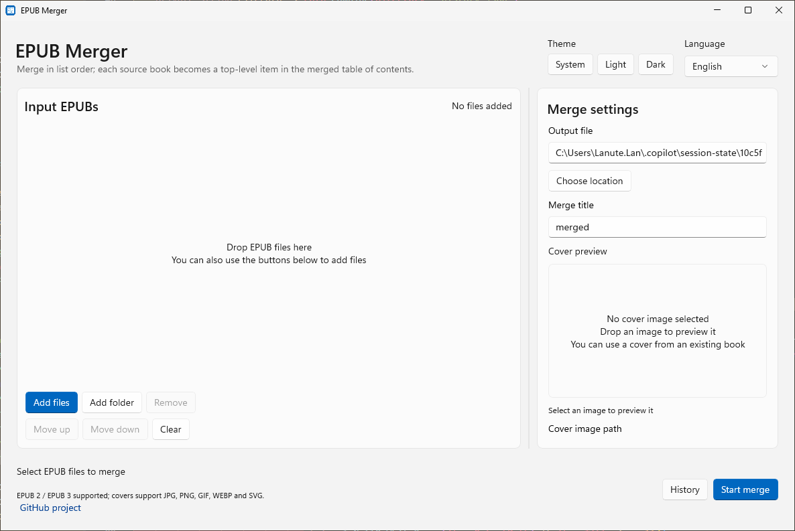
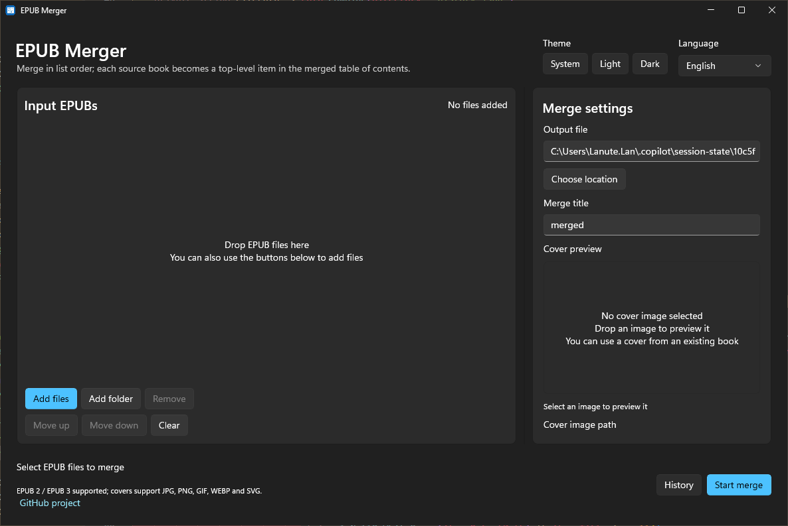
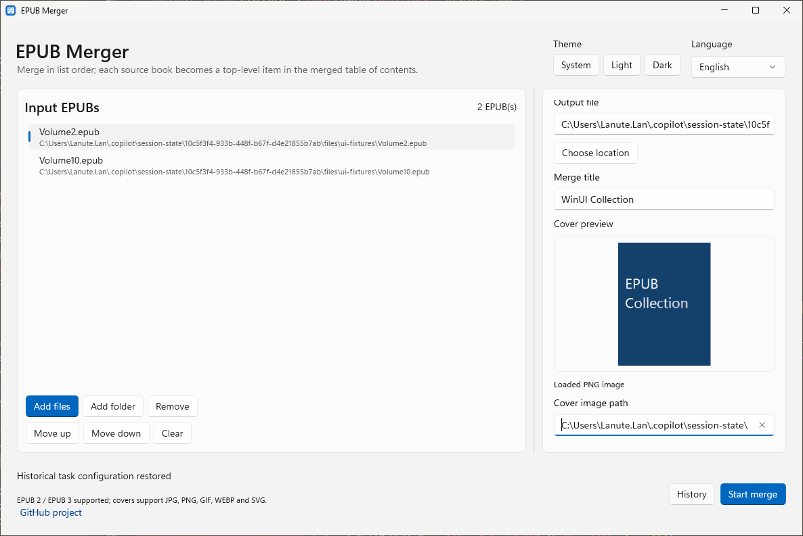

# EPUB Merger

[中文文档](README.md)

A simple Windows desktop EPUB merger with two independent GUIs: the original WPF application and an unpackaged WinUI 3 application. Both use .NET 10; WinUI uses Windows App SDK 2.6.5. It combines multiple EPUB files into a single EPUB 3 file in the specified order, while keeping each source book as a top-level item in the merged contents. The application supports drag-and-drop ordering, custom titles and output paths, cover preview, multilingual UI, and system, light, and dark themes.

## Screenshots

These screenshots show WinUI; WPF retains its original interface.

### Light theme (empty state)



### Dark theme (empty state)



### Application in use



## Features

- Add multiple EPUB files and reorder them by drag and drop or buttons
- Remove selected files or clear the list
- Support EPUB 2 and EPUB 3 input files
- Keep each source book as a top-level item in the merged contents
- Customize the output file path and merged title
- Select or drop a cover image and preview it
- Extract and export a cover image from a source EPUB
- Import EPUB files from folders, including recursive subfolder scanning
- Sort inputs naturally, by name, or keep the original order
- Restore recent tasks
- Cancel a merge while it is running
- Open the output file or its containing folder after a successful merge
- Support JPG, JPEG, PNG, GIF, WEBP, and SVG covers
- Switch between system, light, and dark themes
- Switch the interface between Chinese and English at runtime
- Display localized merge and cover-reading errors while recording detailed logs for troubleshooting
- Show merge progress and synchronize it with the taskbar progress indicator
- Automatically generate the EPUB 3 container, navigation page, and table of contents
- Handle duplicate resource names to prevent files from being overwritten

## Usage

1. Start the application.
2. Click **Add Files**, or drag EPUB files into the list on the left.
3. Select files and use **Move Up** or **Move Down** to adjust the merge order.
4. Set the output file, merged title, and optional cover image on the right.
5. Click **Start Merge**.
6. Wait for the status bar to report completion, then find the generated EPUB file at the configured output location.

The output file must use the `.epub` extension and must not overwrite an input file.

## CLI mode

GitHub packages contain WPF and a standalone CLI executable that does not create a window, in separate `wpf` and `cli` directories. WinUI is distributed only as a Store MSIX. Run the following commands from the `cli` directory:

```powershell
EpubMerge.Cli.exe -i .\vol*.epub -o .\merged.epub --title "Collection"
EpubMerge.Cli.exe -d .\books -r -o .\merged.epub --sort natural
EpubMerge.Cli.exe -i .\one.epub .\two.epub -o .\merged.epub --cover-from-index 1
```

Common options:

- `-i`/`--input`: input EPUB files, wildcards, or a list of paths
- `-d`/`--directory`: scan a directory; use `-r`/`--recursive` to scan subdirectories
- `-o`/`--output`: output EPUB path (required)
- `--cover`: specify an external cover image, or use `--cover-from-index N` to select an embedded cover from the Nth book
- `--sort natural|name|none`: natural sort, name sort, or preserve input order
- `--progress bar|plain|jsonl`: interactive progress bar, stable line records, or JSONL progress events; redirected output automatically falls back to line records by default
- `-q`/`--quiet`, `-v`/`--verbose`: control log output
- `-h`/`--help`, `--version`: display help or version information

CLI exit codes are `0` (success), `1` (argument or input validation failure), and `2` (runtime error or cancellation).
`--quiet` suppresses progress and success output while keeping errors on stderr. `plain` emits line-oriented records such as
`PROGRESS phase=merging completed=1 total=3`; `jsonl` emits one parseable JSON object per line.

## Requirements

- Windows 11, x64 or ARM64 (x64 verified locally; other operating systems must meet both .NET 10 and Windows App SDK support requirements)
- GitHub self-contained packages bundle the .NET / Windows Desktop runtimes required by WPF and CLI
- Framework-dependent WPF requires .NET 10 Desktop Runtime for the matching architecture
- WinUI Store packages include the required .NET support; the Store deploys Windows App Runtime 2.6.5 as a framework dependency. Local unpackaged development requires that runtime to be installed
- Framework-dependent CLI requires .NET 10 Runtime for the matching architecture
- WinUI cover previews use system image decoders; unsupported images produce an explicit preview error without modifying the source

The GUIs do not import or synchronize each other's data. WPF retains its original behavior: history in `EpubMerge.Gui\history.json` beneath the application directory, logs in the application directory, and theme settings in `HKCU\Software\EpubMerge.Gui`. WinUI retains history, logs and cache in `%LOCALAPPDATA%\EpubMerge`, with an independent theme key at `HKCU\Software\EpubMerge.Gui.WinUI`; it does not automatically import WPF history.

## Build

### WinUI interface languages

The language dropdown button shows the current language and marks the selected menu item. WinUI supports Simplified Chinese, Traditional Chinese, English, Japanese, Korean, French, German, Spanish, Brazilian Portuguese and Russian. Language names are shown in their own language.

On first launch, the system UI language is matched to a supported language, falling back to English. Explicit choices are saved in `LanguagePreference` under `HKCU\Software\EpubMerge.Gui.WinUI` and take priority on later launches. The initial system match is not saved. To follow the system again, close WinUI and remove only that registry value.

Switching translates the application UI, not book titles, filenames, EPUB contents or third-party exception text. System pickers may use the system language. Native-speaker review of the new translations is welcome. WPF remains bilingual; CLI behavior is unchanged.

Run the following commands from the repository root:

```powershell
dotnet restore EpubMerge.slnx -p:Platform=x64
dotnet build EpubMerge.slnx -p:Platform=x64
dotnet test EpubMerge.slnx -p:Platform=x64
```

Run WPF:

```powershell
dotnet run --project src\EpubMerge.Gui\EpubMerge.Gui.csproj
```

Run WinUI:

```powershell
dotnet run --project src\EpubMerge.Gui.WinUI\EpubMerge.Gui.WinUI.csproj -p:Platform=x64
```

Run the CLI project:

```powershell
dotnet run --project src\EpubMerge.Cli\EpubMerge.Cli.csproj -- --help
```

## GitHub Actions release

The repository includes a GitHub Actions workflow. Pushing to `master` or opening a pull request automatically restores dependencies, builds the project, and runs the tests.

To publish a release, create and push a tag beginning with `V`, for example:

```powershell
git tag V1.0.0
git push origin V1.0.0
```

Before pushing the tag, update `RELEASE_NOTES.md` in the repository root with the user-visible changes for that version. The workflow writes this file to the GitHub Release description and appends GitHub-generated commit notes.

The workflow builds both GUIs and runs all tests, then creates four archives on a Windows runner: self-contained and framework-dependent packages for both `win-x64` and `win-arm64`. Each archive contains:

```text
wpf\EpubMerge.Gui.exe
cli\EpubMerge.Cli.exe
```

Dependencies are isolated across the two directories. WPF and CLI retain single-file managed assembly bundling; keep any accompanying native dependencies. Self-contained packages include the required runtimes. If an old output directory still contains `winui`, move it elsewhere or explicitly use `-Clean`.

Development requires the .NET 10 SDK, Visual Studio WinUI tools and Windows SDK 26100. `global.json` excludes preview SDKs. Local ARM tools are not required. Experimental WinUI Native AOT additionally requires Desktop development with C++ and MSVC x64/x86 tools; WPF/CLI do not use AOT.

## Microsoft Store MSIX

WinUI also supports an explicit single-project MSIX mode. GitHub Release continues to distribute only unpackaged ZIPs. Store packages embed .NET and declare Windows App SDK framework dependencies for Store deployment; they do not include WPF or CLI.

```powershell
# Explicit demo identity, NOT suitable for a real Store submission.
.\publish-store.ps1 -PackageVersion 1.2.3.0 -RuntimeIdentifier win-x64 -Demo
```

The independent **Build Microsoft Store packages** workflow is **manual-only**, with an explicit version and demo/production choice. `compilation_mode` defaults to `Managed`, with experimental `NativeAot` available. Both use the same Windows App SDK framework dependency, not a second SDK deployment tier. Packages are saved only as Actions artifacts for manual Store submission, never attached to GitHub Release. V tags publish only WPF/CLI ZIPs. Production builds fail until real product identity is configured.

x64 native compilation, actual AOT MSIX payload validation and unpackaged localization/theme/history/real-merge comparison with Managed pass. Packaged installation/runtime acceptance and ARM64 verification remain pending, so Managed remains the Store default. See the Store guide for diagnostic commands and isolated-environment acceptance.

See the [Microsoft Store setup and first-submission guide (Chinese)](docs/MICROSOFT-STORE.md) to continue from another computer: product creation, identity configuration, versions, signing/local testing, artifact downloads and manual Partner Center submission.

## Project structure

```text
src/
  EpubMerge.Core.Pure/  EPUB validation and merge logic
  EpubMerge.Cli/        Standalone command-line application
  EpubMerge.Gui/        Original WPF GUI with independent ViewModels/resources
  EpubMerge.Gui.WinUI/  WinUI 3, unpackaged by default with explicit Store MSIX mode
  EpubMerge.Presentation/ WinUI ViewModels, localization and storage
tests/
  EpubMerge.Core.Tests/ Core logic tests
  EpubMerge.Cli.Tests/   CLI behavior and output tests
  EpubMerge.Gui.Tests/  Original WPF ViewModel tests
  EpubMerge.Presentation.Tests/ WinUI presentation tests without GUI framework loading
  Packaging/           Store configuration failure-case tests
packaging/             Store product identity configuration (initially blank)
docs/                  Cross-computer setup and first-submission guide
readmeRef/              README screenshots
```

## Notes

- The merged result is an EPUB 3 container with regenerated navigation and table-of-contents information.
- Encrypted or font-obfuscated EPUB files containing `META-INF/encryption.xml` are not currently supported.
- Source files are read only; the application does not modify the original EPUB files.

## Disclaimer

The WinUI footer includes the author, a vector GitHub icon linking to the project, and a **Disclaimer** link. The disclaimer is always displayed in English; its Close button follows the selected UI language.

EPUB Merger is provided "as is", without warranty of any kind, express or implied. To the extent permitted by applicable law, the authors and copyright holders are not liable for claims, damages or other liability arising from its use.

Keep backups and verify merged files before relying on them. Compatibility with every EPUB file or reader is not guaranteed.

Only process content that you own or are authorized to use. You are responsible for complying with applicable copyright laws and license terms. This application does not remove DRM or grant rights to third-party content.

See the MIT License in the project repository for the full license terms.

## License

This project is licensed under the terms in [LICENSE](LICENSE).